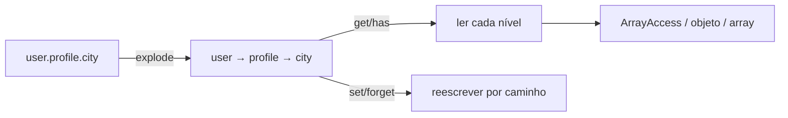

# Arr

> Acesso e transformação de arrays com notação em ponto e sem efeitos colaterais.

[← Portal](../../README.md)

## Introdução

Arr concentra leitura, escrita e agrupamento de estruturas aninhadas. Escritas devolvem uma nova cópia; o array original nunca é modificado. Leituras aceitam `ArrayAccess` e propriedades públicas de objetos nos níveis intermediários.

Use em configuração, payloads e DTOs convertidos para array. Não use como coleção mutável ou ORM — para transporte tipado, prefira [DTO](../Dto/README.md).

## Recursos

- ✅ notação em ponto (`user.profile.city`);
- ✅ `get`/`has` distinguindo `null` de ausente;
- ✅ `set`/`forget` imutáveis;
- ✅ `pluck`, `groupBy`, `only`;
- ✅ `dot`/`undot` idempotentes;
- ✅ `first`/`last` com callback opcional;
- ✅ leitura via `ArrayAccess` e objetos;
- ✅ zero dependências.

## Início rápido

```php
use Omegaalfa\Utils\Arr\Arr;

$data = ['user' => ['name' => 'Ada', 'tags' => ['php']]];

Arr::get($data, 'user.name');          // 'Ada'
Arr::has($data, 'user.email');         // false
$new = Arr::set($data, 'user.age', 36); // novo array
```

PHP 8.4+.

## Conceitos

Todo caminho é uma lista de segmentos separados por `.`. Segmento vazio (`a..b`) é rejeitado. Intermediários não-array em `set()` são substituídos por array; em `forget()` o caminho simplesmente não desce.



Leitura por nível: array → `ArrayAccess` (semântica `isset`) → propriedades públicas do objeto. Escrita opera somente sobre arrays.

## Casos de uso

### Extrair colunas de uma lista

```php
$emails = Arr::pluck($users, 'contact.email', default: null);
```

### Agrupar por chave ou regra

```php
$byType = Arr::groupBy($rows, 'type');

$byParity = Arr::groupBy($numbers, static fn (mixed $n): string =>
    (is_int($n) && $n % 2 === 0) ? 'even' : 'odd');
```

### Filtrar campos de saída

```php
$public = Arr::only($payload, ['id', 'name', 'profile.city']);
```

### Achatar e restaurar configuração

```php
$flat = Arr::dot(['db' => ['host' => 'localhost']]);
// ['db.host' => 'localhost']

$nested = Arr::undot($flat);
// ['db' => ['host' => 'localhost']]
```

## API

| Método | Retorna | Comportamento |
|---|---|---|
| `Arr::get(array $array, string\|int $key, mixed $default = null)` | `mixed` | `null` explícito é valor válido; use `has()` para existência. |
| `Arr::has(array $array, string\|int $key)` | `bool` | Verdadeiro também para caminho com valor `null`. |
| `Arr::set(array $array, string\|int $key, mixed $value)` | `array` | Cria níveis intermediários; nunca muta a entrada. |
| `Arr::forget(array $array, string\|int ...$keys)` | `array` | Remove cada caminho; ausentes são ignorados. |
| `Arr::pluck(array $array, string\|int $key, mixed $default = null)` | `array` | Preserva as chaves originais. |
| `Arr::groupBy(array $array, string\|int\|callable $by)` | `array` | Chave precisa ser `string\|int`; caminho ausente lança `InvalidArgumentException`. |
| `Arr::only(array $array, array $keys)` | `array` | Reconstrói a estrutura aninhada dos caminhos pedidos. |
| `Arr::dot(array $array)` | `array` | Arrays vazios são folhas; round-trip não é estável para chaves contendo `.`. |
| `Arr::undot(array $array)` | `array` | Expande chaves em ponto de volta para arrays. |
| `Arr::first(array $array, ?callable $callback = null, mixed $default = null)` | `mixed` | Primeira ocorrência; callback recebe `(valor, chave)`. |
| `Arr::last(array $array, ?callable $callback = null, mixed $default = null)` | `mixed` | Última ocorrência; callback recebe `(valor, chave)`. |

## Performance e limitações

Todas as operações são lineares no tamanho do caminho ou da lista. `set`/`forget` copiam os níveis percorridos (copy-on-path), não o array inteiro — o custo cresce com a profundidade, não com o volume total. Não há suporte a curingas (`a.*.b`), merge profundo ou ordenação.

## Boas práticas

- prefira `has()` quando `null` é valor legítimo;
- não passe caminhos montados com entrada não sanitizada sem validar;
- use `only()` para reduzir payload em vez de `unset()` imperativo;
- não guarde referências ao array original esperando mutação;
- para objetos, limite o acesso a propriedades públicas — privadas são invisíveis por design.

## FAQ e troubleshooting

**Chave numérica funciona?** Sim: `Arr::get($a, 0)` e `Arr::get($a, '0')` alcançam o mesmo item.

**Por que `dot()` quebrou chaves com ponto?** O formato não tem escape; normalize as chaves antes de achatar.

**`get()` não lê propriedade privada?** Correto — somente públicas, como qualquer código externo.

| Problema | Solução |
|---|---|
| `Array key path cannot be empty segments` | Remova pontos duplicados ou sobras (`a..b`, `a.`). |
| `Unable to group by missing or non-scalar path` | Use callback ou garanta que o caminho existe e é escalar. |
| Valor sumiu após `set` em intermediário escalar | `set()` substitui não-arrays por array no caminho. |
| `ArrayAccess` com valor `null` some | `offsetExists` usa semântica `isset`; trate no próprio objeto. |

## Oportunidades de melhoria

Curingas, merge profundo e `pluck` reverso devem ser APIs separadas para preservar a previsibilidade do núcleo. Um contrato de coleção tipada pode integrar este módulo sem alterar as funções estáticas.

## Contribuição e licença

Execute `composer check`; teste caminhos, `null`, objetos e imutabilidade. Licença [MIT](../../LICENSE).
