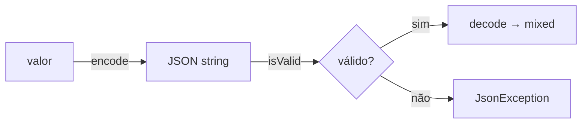

# Json

> Codificação e decodificação JSON com falhas explícitas e sem ambiguidade.

[← Portal](../../README.md)

## Introdução

Json concentra `json_encode`, `json_decode` e `json_validate` atrás de um contrato único: sucesso retorna valor, falha lança `JsonException` — nunca `false` ou `null` silencioso.

Use em payloads de API, configuração serializada e validação de entrada. Não use para streaming NDJSON ou formatos binários; esses casos pedem [Stream](../Stream/README.md).

## Recursos

- ✅ `encode()` sempre com `JSON_THROW_ON_ERROR`;
- ✅ flags nativas opcionais;
- ✅ `decode()` associativo ou objeto;
- ✅ `isValid()` sem materializar o conteúdo;
- ✅ profundidade máxima fixa de 512;
- ✅ zero dependências.

## Início rápido

```php
use Omegaalfa\Utils\Json\Json;

$json = Json::encode(['nome' => 'Ada']);
$data = Json::decode($json);
// ['nome' => 'Ada']

Json::isValid('{"ok":true}'); // true
```

PHP 8.4+.

## Conceitos



`encode()` e `decode()` nunca retornam `false`/`null` por erro: erro de sintaxe ou estrutura vira `JsonException`. `isValid()` é o único caminho não lançante.

## Casos de uso

### Serializar sem surpresas

```php
use JsonException;
use Omegaalfa\Utils\Json\Json;

try {
    $body = Json::encode($payload, JSON_UNESCAPED_UNICODE);
} catch (JsonException $error) {
    // recurso, NAN ou profundidade excedida
}
```

### Validar entrada antes de decodificar

```php
if (!Json::isValid($raw)) {
    return Response::badRequest();
}

$data = Json::decode($raw);
```

### Decodificar como objeto

```php
$config = Json::decode($raw, associative: false);
```

## API

| Método | Retorna | Comportamento |
|---|---|---|
| `Json::encode(mixed $value, int $flags = 0)` | `string` | Sempre aplica `JSON_THROW_ON_ERROR`; lança `JsonException` em falha. |
| `Json::decode(string $json, bool $associative = true)` | `mixed` | Objeto vira array quando `$associative` é true; lança `JsonException` em JSON inválido. |
| `Json::isValid(string $json)` | `bool` | Usa `json_validate()`; não lança e não aloca o valor. |

`encode()` aceita qualquer flag de `json_encode()` além de `JSON_THROW_ON_ERROR`, que já está ativa. A profundidade máxima é 512 nos três métodos.

## Performance e limitações

O caminho feliz delega direto às funções nativas. `isValid()` evita o custo de materializar árvores grandes. Não há suporte a profundidade configurável, `JSON_INVALID_UTF8_*` automáticos ou streaming; documente isso na borda de integração.

## Boas práticas

- prefira `isValid()` quando só precisa confirmar a sintaxe;
- trate `JsonException` na borda, não dentro de loops apertados;
- use `JSON_UNESCAPED_UNICODE`/`JSON_UNESCAPED_SLASHES` consciente do contrato de consumo;
- não concatene strings JSON manualmente — codifique estruturas;
- para helpers globais `arrayToJson()`/`jsonToArray()`, veja [Helpers](../../helpers/README.md).

## FAQ e troubleshooting

**`decode('null')` retorna `null` e parece erro?** Não: JSON `null` é válido. Se precisa distinguir "ausente", verifique a string antes.

**Por que não existe retorno `?string`?** Contrato único: ou a string, ou exception. Helpers globais oferecem o modo leniente.

**`isValid('')` é `false`?** Sim; string vazia não é JSON.

| Problema | Solução |
|---|---|
| `JsonException` em `encode()` | Remova resources, NAN/INF ou ciclos. |
| Profundidade excedida | Achate a estrutura antes de codificar. |
| Chaves numéricas viram strings | Comportamento nativo de objetos JSON; normalize na origem. |

## Oportunidades de melhoria

Profundidade configurável, flags de UTF-8 inválido por método e um encoder incremental para NDJSON devem ser APIs separadas. Integração com PSR-7 pode delegar a este módulo sem alterar o contrato.

## Contribuição e licença

Execute `composer check`; teste sucesso, exceções e `isValid()`. Licença [MIT](../../LICENSE).
