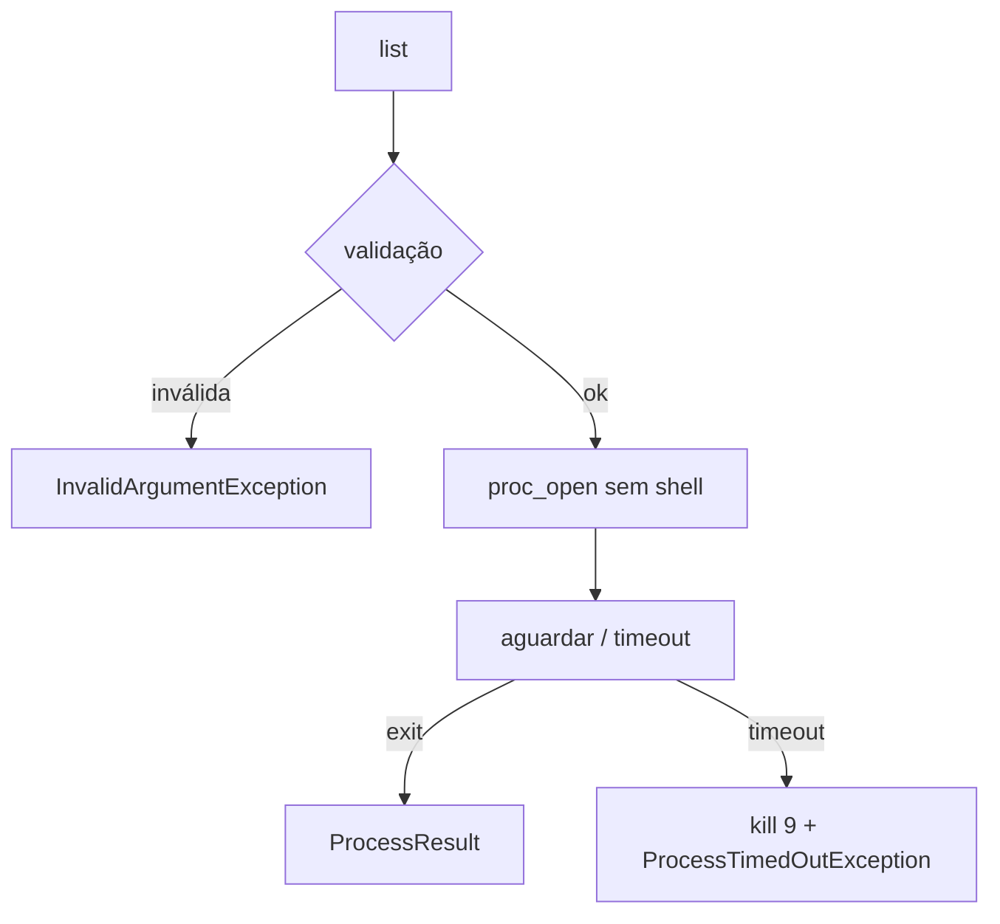

# Process

> Executar comandos sem shell, capturando saída, erro e código de saída.

[← Portal](../../README.md)

## Introdução

Process executa um comando em formato de lista de argumentos (`argv`), sem passar por shell — sem interpretação de `;`, `|`, `$()` ou crases. A saída e o erro são capturados em arquivos temporários, evitando deadlock de pipes em saídas grandes. O retorno é um `ProcessResult` imutável.

Use em CLIs, integrações locais e wrappers de binários. Não use para processos interativos, streaming em tempo real ou shells complexos; para scripts PHP por menu, veja [ScriptRunner](../ScriptRunner/README.md).

## Recursos

- ✅ comando somente como lista de strings;
- ✅ timeout com encerramento forçado do processo;
- ✅ captura separada de `stdout` e `stderr`;
- ✅ código de saída confiável;
- ✅ diretório de trabalho opcional;
- ✅ `ProcessResult` imutável;
- ✅ `ProcessTimedOutException` para integração com [Retry](../Retry/README.md);
- ✅ zero dependências.

## Início rápido

```php
use Omegaalfa\Utils\Process\Process;

$result = Process::run([PHP_BINARY, '-v']);

$result->ok();      // true
$result->exitCode(); // 0
$result->stdout();   // texto da versão
```

PHP 8.4+.

## Estratégia

`proc_open()` recebe o comando como lista, com `bypass_shell` e stdin fechado. `stdout`/`stderr` vão para arquivos temporários distintos, então grandes volumes não bloqueiam. Enquanto o processo roda, o status é consultado em intervalos curtos; ao estourar o timeout, o processo é terminado com sinal 9 e `ProcessTimedOutException` é lançada.



## Casos de uso

### Invocar binário com argumentos literais

```php
$result = Process::run(['git', 'log', '--oneline', '-n', '5']);

if (!$result->successful()) {
    throw new RuntimeException($result->stderr());
}
```

### Limitar tempo de execução

```php
try {
    Process::run(['composer', 'audit'], timeoutSeconds: 30.0);
} catch (ProcessTimedOutException) {
    // trate como falha transitória
}
```

### Executar em outro diretório

```php
$result = Process::run(
    [PHP_BINARY, '-r', 'echo getcwd();'],
    workingDirectory: '/var/www/app',
);
```

## API

`Process::run()` recebe:

| Parâmetro | Padrão | Significado |
|---|---:|---|
| `command` | obrigatório | `list<string>`: programa seguido dos argumentos. |
| `timeoutSeconds` | 60.0 | Teto em segundos; `null` espera indefinidamente. |
| `workingDirectory` | null | Diretório existente; padrão é o cwd atual. |

Retorna `ProcessResult` (read-only):

| Método | Retorna | Significado |
|---|---|---|
| `ok()` / `successful()` | `bool` | `true` quando `exitCode === 0`. |
| `exitCode()` | `int` | Código de saída do processo. |
| `stdout()` | `string` | Saída padrão capturada. |
| `stderr()` | `string` | Erro padrão capturado. |
| `command()` | `list<string>` | Comando executado, para rastreio. |

Exceptions: `InvalidArgumentException` (comando, timeout ou diretório inválidos), `ProcessTimedOutException` (excedeu o orçamento e foi morto), `RuntimeException` (falha ao iniciar ou ler saída).

## Performance e limitações

Cada execução cria dois arquivos temporários e faz polling a cada 10 ms — adequado para CLIs e jobs, não para microchamadas em loop apertado. Não há streaming de saída em tempo real, stdin configurável, env customizada, grupos de processo ou captura de sinal. Em Windows, o sinal de encerramento é equivalente à terminação nativa.

## Boas práticas

- passe sempre o comando como lista, nunca como string de shell;
- defina timeout realista para cada comando;
- verifique `ok()`/`exitCode()` antes de consumir `stdout()`;
- não construa argumentos concatenando entrada do usuário sem validar;
- trate `ProcessTimedOutException` como transitória em conjunto com Retry.

## FAQ e troubleshooting

**Posso passar `['sh', '-c', $cmd]`?** Funciona, mas devolve a você a injeção de shell — use apenas com entrada confiável.

**Por que não pipes?** Saídas grandes deadlock em pipes não lidos; arquivos temporários eliminam o problema.

**`ok()` e `successful()` diferem?** Não; são aliases para legibilidade.

| Problema | Solução |
|---|---|
| `Unable to start process` | Confirme que o programa existe e é executável. |
| `Process exceeded the timeout` | Aumente o orçamento ou otimize o comando. |
| Argumento com espaço quebra | Mantenha cada parte como item da lista. |
| Saída vazia inesperada | Verifique se o comando escreve em `stdout` e não em arquivo. |

## Oportunidades de melhoria

Streaming incremental, stdin configurável, variáveis de ambiente e grupos de processos devem ser APIs separadas — o núcleo permanece mínimo e sem shell. Integração com [Stream](../Stream/README.md) para consumir saída em tempo real pode ser adicionada sem mudar `ProcessResult`.

## Contribuição e licença

Execute `composer check`; teste timeout, separação de streams e injeção. Licença [MIT](../../LICENSE).
