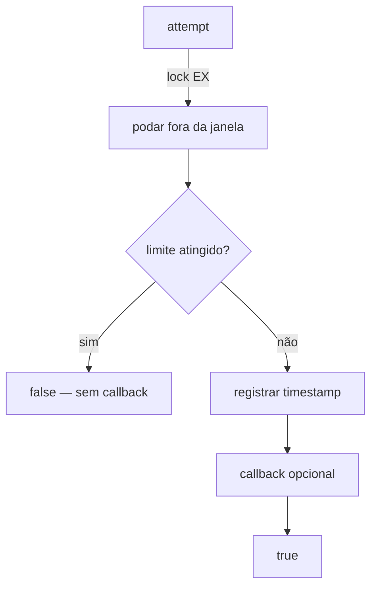

# RateLimiter

> Limite de tentativas por chave com janela deslizante em arquivos locais.

[← Portal](../../README.md)

## Introdução

FileRateLimiter controla quantas ações uma chave pode executar dentro de uma janela de tempo. Cada chave é um arquivo JSON com os timestamps das tentativas recentes; toda gravação usa lock exclusivo, então processos paralelos não estouram o limite.

Use em proteção de login, APIs locais e cotas de tarefa. Não use como rate limiting distribuído entre servidores — para isso existe Redis/outro armazenamento compartilhado.

## Recursos

- ✅ janela deslizante por chave;
- ✅ lock exclusivo (`flock`) por arquivo;
- ✅ `attempt()` com callback opcional;
- ✅ consulta somente-leitura `tooManyAttempts()`;
- ✅ `remaining()` e `reset()`;
- ✅ chave isolada por SHA-256 no nome do arquivo;
- ✅ diretório configurável;
- ✅ zero dependências.

## Início rápido

```php
use Omegaalfa\Utils\RateLimiter\FileRateLimiter;

$limiter = new FileRateLimiter('/var/tmp/rl', maxAttempts: 5, decaySeconds: 60);

if (!$limiter->attempt('login:' . $email)) {
    // bloqueie a tentativa
}
```

PHP 8.4+.

## Conceitos

A janela deslizante guarda o timestamp de cada tentativa permitida. Antes de decidir, entradas fora da janela são descartadas. `attempt()` consome uma unidade quando permite; `tooManyAttempts()` apenas consulta e nunca altera o estado.



## Casos de uso

### Proteger login

```php
$key = 'login:' . $email;

if (!$limiter->attempt($key)) {
    throw new AuthenticationException('Muitas tentativas. Aguarde.');
}

// valide credenciais...
```

### Executar algo apenas quando permitido

```php
$limiter->attempt('sync', function () use ($service): void {
    $service->run();
});
```

### Consulta sem consumir cota

```php
if ($limiter->tooManyAttempts('export', maxAttempts: 3, decaySeconds: 3600)) {
    return Response::tooManyRequests();
}

$available = $limiter->remaining('login:' . $email);
```

### Liberar após sucesso

```php
$limiter->reset('login:' . $email);
```

## API

`new FileRateLimiter(string $directory, int $maxAttempts = 60, int $decaySeconds = 60)`

| Método | Retorna | Comportamento |
|---|---|---|
| `attempt(string $key, ?callable $callback = null)` | `bool` | Consome uma unidade quando permite; callback roda só nesse caso. |
| `tooManyAttempts(string $key, int $maxAttempts, int $decaySeconds)` | `bool` | Consulta somente-leitura com limites customizados. |
| `remaining(string $key)` | `int` | Unidades restantes na janela configurada; nunca negativo. |
| `reset(string $key)` | `void` | Zera todas as tentativas da chave. |

O diretório é criado se não existir (modo `0700`); links simbólicos são rejeitados. Cada chave vira `<sha256>.json` dentro dele — a chave original nunca aparece no filesystem.

## Performance e limitações

Cada operação abre o arquivo da chave, toma `flock`, lê, reescreve e libera. O custo cresce com o número de chaves distintas no diretório, não com o total acumulado (arquivos antigos podem ser removidos externamente quando não há mais tráfego). Não há limpeza automática de chaves ociosas, compartilhamento entre hosts ou regra por IP/identidade — isso fica a cargo da aplicação.

Janelas diferentes na mesma chave compartilham o mesmo log de timestamps. `tooManyAttempts()` nunca poda dados; `attempt()` poda com a janela da instância. Configure um limiter por regra, ou use a mesma janela nos dois caminhos.

## Boas práticas

- derive a chave de um identificador estável (usuário, IP + rota, cliente);
- use diretório fora do público web e com permissão restrita;
- não faça `attempt()` em transação que pode reverter sem querer consumir cota — o consumo é imediato;
- combine com Retry apenas em operações idempotentes;
- para limpar, remova arquivos antigos por fora (cron) quando as chaves forem de vida curta.

## FAQ e troubleshooting

**`attempt()` consome cota se o callback lançar?** Sim; a tentativa já foi registrada.

**Race condition entre workers?** O `flock` serializa a decisão; um deles será rejeitado no limite.

**Posso usar diretório do usuário atual?** Sim, desde que não seja symlink e o processo possa escrever nele.

| Problema | Solução |
|---|---|
| `Unable to open rate limiter file` | Verifique permissões do diretório. |
| `Symbolic links cannot be rate limiter directories` | Aponte para o diretório real. |
| Limite nunca atinge | Confirme que `decaySeconds` é compatível com o intervalo das tentativas. |
| Cota "sumiu" após recriar diretório | Estado é o arquivo; não delete o diretório em produção. |

## Oportunidades de melhoria

Token bucket, limpeza automática de chaves ociosas e armazenamento compartilhado (Redis) devem ser implementações separadas da mesma interface. Métricas podem integrar o [Profiler](../Profiler/README.md) sem criar dependência obrigatória.

## Contribuição e licença

Execute `composer check`; teste limite, isolamento de chave e concorrência. Licença [MIT](../../LICENSE).
